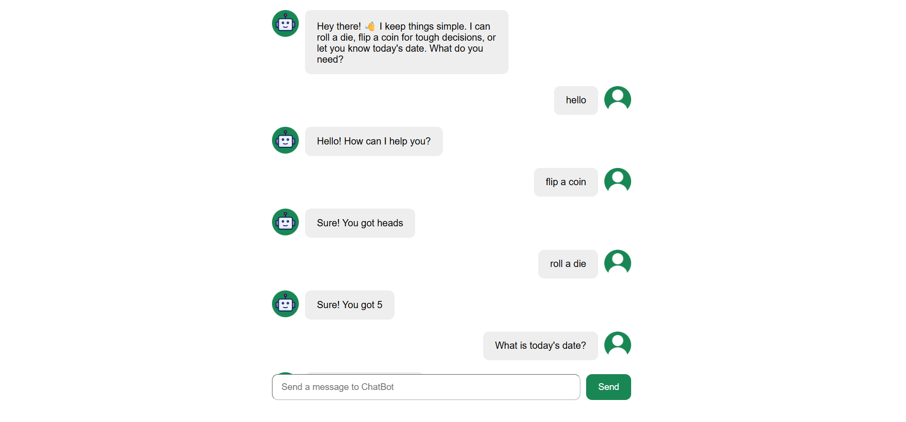

# Chatbot Project

A simple interactive chatbot built using React, featuring dynamic message rendering, user input handling, and reusable components.

This project is part of my hands-on exploration of React and frontend development.

## Preview



## Tech Stack
- React
- JavaScript
- HTML
- CSS

## Getting Started

Clone the repository:

```bash
git clone https://github.com/harsharagain/codeverse.git
```

Navigate to the chatbot project directory:

```bash
cd codeverse/react/chatbot-project
```

Install the dependencies:

```bash
npm install
```

Start the development server:

```bash
npm run dev
```

## Reference
SuperSimpleDev – React Course